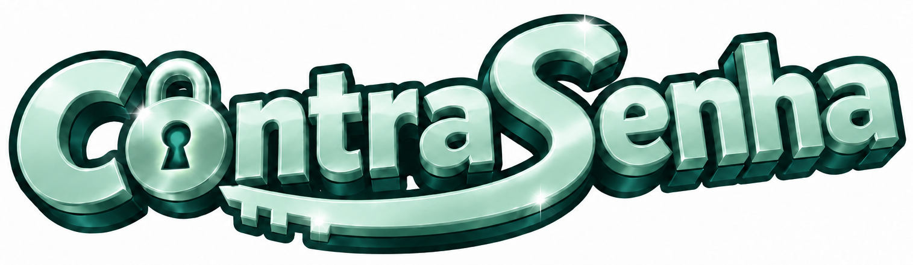

# ContraSenha

  

Repositório destinado ao desenvolvimento do jogo ContraSenha, na linguagem C, como requisito para obtenção de nota na disciplina de Programação Imperativa e Funcional (PIF).

### Requisitos:
Usar obrigatoriamente:
- Estruturas (structs);
- Ponteiros;
- Alocação dinâmica de memória;
- Listas encadeadas;
- Matrizes
- Escrita e leitura em arquivo;

### Descrição do jogo:
O jogador deve inserir uma senha e, com o andamento do jogo, regras aparecerão e este deverá alterá-la para que cumpra todos os requisitos.

"Hoje em dia, as senhas são utilizadas para tudo no nosso cotidiano. Quanto mais difíceis de serem adivinhadas, mais seguras estão nossas informações. ContraSenha é um jogo onde você tem que obedecer todas as nossas regras para criar sua senha segura e manter seus dados a salvo. Será que você consegue cumprir todos os requisitos?"

### Links Úteis:
- [Vídeo de demonstração e breve explicação do jogo](https://www.youtube.com/watch?v=TUTJDmAcIT4)
- [Slides de apresentação](https://canva.link/13s5dd9gfzm1kks)

### Membros:
| Nome | E-mail |
|---|---|
| Eraldo Carneiro Leão Neto | [ecln@cesar.school](https://mail.google.com/mail/?view=cm&amp;fs=1&amp;to=ecln@cesar.school&amp;su=Contato%20sobre%20o%20projeto%20de%20pif) |
| Gabriella de Lima Albuquerque | [gla3@cesar.school](https://mail.google.com/mail/?view=cm&amp;fs=1&amp;to=gla3@cesar.school&amp;su=Contato%20sobre%20o%20projeto%20de%20pif) |
| Laís Araújo Moura | [lam2@cesar.school](https://mail.google.com/mail/?view=cm&amp;fs=1&amp;to=lam2@cesar.school&amp;su=Contato%20sobre%20o%20projeto%20de%20pif) |
